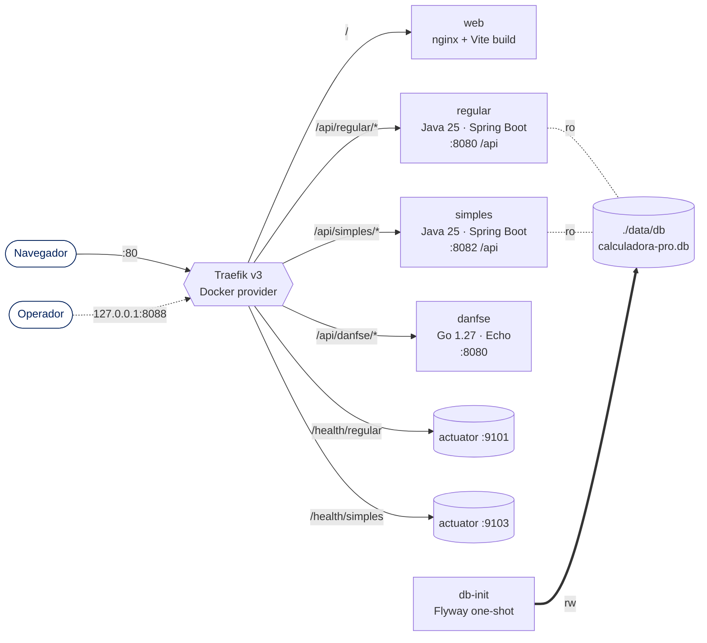

# RTC Lab

Laboratório open source para exercitar, de forma interativa, os motores de cálculo e geração de documentos publicados pela Receita Federal para a **Reforma Tributária do Consumo (RTC)**: a calculadora do Regime Regular, a calculadora do Simples Nacional e o gerador de DANFSe.

> **Aviso:** RTC Lab é um projeto independente de demonstração. Não é um sistema oficial da Receita Federal. Os cálculos são realizados pelos motores open source disponibilizados pela Receita Federal e devem ser utilizados apenas para fins de experimentação e aprendizado.

## Índice

1. [Visão geral](#1-visão-geral)
2. [Arquitetura](#2-arquitetura)
3. [Stack tecnológica](#3-stack-tecnológica)
4. [Motores oficiais](#4-motores-oficiais)
5. [Pré-requisitos](#5-pré-requisitos)
6. [Instalação e execução](#6-instalação-e-execução)
7. [Serviços e endpoints](#7-serviços-e-endpoints)
8. [Banco de dados SQLite local](#8-banco-de-dados-sqlite-local)
9. [Utilização](#9-utilização)
10. [Catálogo de cenários](#10-catálogo-de-cenários)
11. [Atualização dos motores](#11-atualização-dos-motores)
12. [Testes](#12-testes)
13. [Segurança](#13-segurança)
14. [Identidade visual](#14-identidade-visual)
15. [Problemas conhecidos](#15-problemas-conhecidos)
16. [Limitações](#16-limitações)
17. [Licença](#17-licença)

## 1. Visão geral

O RTC Lab é uma camada de experimentação sobre os motores oficiais. **Nenhuma regra tributária é reimplementada**: todo cálculo, validação e geração de documento é executado pelos motores originais, que rodam em containers independentes, sem modificação de código-fonte.

Principais capacidades:

- **Bancada de testes** por motor, com formulário e resposta lado a lado, no padrão de clientes de API.
- **Catálogo de cenários** versionado e validado continuamente contra os motores reais.
- **Playground de APIs** com geração de `curl` equivalente, **comparador** estrutural de respostas e **histórico** local.
- **Painel de disponibilidade** baseado nos endpoints de saúde reais de cada motor.

## 2. Arquitetura

Todo o tráfego do navegador passa por um único *reverse proxy* (Traefik), configurado exclusivamente por *labels* do Docker. Não há backend intermediário: a interface consome diretamente as APIs oficiais, na mesma origem.



O serviço `db-init` é um *job* idempotente que materializa a base SQLite a partir dos scripts Flyway oficiais antes de os motores Java iniciarem:

```mermaid
sequenceDiagram
    autonumber
    participant C as docker compose up
    participant I as db-init
    participant V as ./data/db
    participant M as regular / simples
    participant T as traefik / web

    C->>I: inicia (build com cache Maven)
    I->>I: calcula SHA-256 dos scripts Flyway
    alt base existe e .built-for coincide
        I-->>C: encerra (nada a fazer)
    else base ausente ou desatualizada
        I->>I: flyway:migrate em diretório temporário
        I->>V: move atomicamente calculadora-pro.db + .built-for
        I-->>C: encerra (exit 0)
    end
    C->>M: inicia após service_completed_successfully
    M->>V: abre o SQLite em modo somente leitura
    M-->>C: healthcheck (actuator) UP
    C->>T: inicia; roteia apenas containers saudáveis
```

Decisões de projeto detalhadas, com os achados da análise dos três repositórios, estão em [docs/pesquisa-tecnica.md](docs/pesquisa-tecnica.md).

## 3. Stack tecnológica

| Camada | Tecnologias |
|---|---|
| Interface | Vite, TypeScript, Bootstrap 5, CodeMirror 6 (editores JSON/XML) |
| Entrega | nginx (estáticos), Traefik v3 (roteamento por *labels*) |
| Orquestração | Docker, Docker Compose, builds multi-stage com cache de dependências |
| Motores | Java 25 + Spring Boot 4 (Regime Regular, Simples Nacional); Go 1.27 + Echo (DANFSe) |
| Persistência dos motores | SQLite (somente leitura), gerado via Flyway |
| Testes | Vitest (unitários e integração), Playwright (E2E) |

A interface é TypeScript modular, sem framework de UI. O estado de histórico e de preferências fica no `localStorage` do navegador.

## 4. Motores oficiais

Incorporados como *Git submodules* em `services/`, fixados nas tags de release e sem qualquer alteração.

| Motor | Repositório | Tag |
|---|---|---|
| Regime Regular | https://github.com/ReceitaFederal/calculadora-rtc-regime-regular | `1.7.2` |
| Simples Nacional | https://github.com/ReceitaFederal/calculadora-rtc-simples-nacional | `1.0.2` |
| Gerador DANFSe | https://github.com/ReceitaFederal/calculadora-rtc-gerador-danfse | `1.0.0` |

Os repositórios oficiais não distribuem `Dockerfile` utilizável (o do DANFSe fixa `GOARCH=amd64`); por isso os *Dockerfiles* próprios ficam em `infrastructure/`.

## 5. Pré-requisitos

- Docker Engine com Compose v2 (validado com Docker 29 e Compose 5).
- Git.
- Acesso à internet na primeira construção (Docker Hub, Maven Central, Go modules, npm).
- Aproximadamente 4 GB de memória disponíveis para o Docker.
- Node.js 24 e `sqlite3` apenas se for executar os testes ou inspecionar o banco fora de containers.

## 6. Instalação e execução

Clone o repositório **já com os submodules** e inicie a stack:

```bash
git clone --recurse-submodules https://github.com/robertheory/rtc-lab.git
```

```bash
cd rtc-lab
```

```bash
docker compose up --build
```

Caso o clone tenha sido feito sem `--recurse-submodules`:

```bash
git submodule update --init
```

Para executar em segundo plano e aguardar todos os *healthchecks*:

```bash
docker compose up --build --wait -d
```

Parar os serviços, preservando o banco em `./data/db`:

```bash
docker compose down
```

Configurações opcionais (portas do host e flags da JVM) podem ser definidas copiando `.env.example` para `.env`:

```bash
cp .env.example .env
```

> **Apple Silicon:** se o shell exporta `DOCKER_DEFAULT_PLATFORM=linux/amd64`, os containers são construídos sob emulação. Execute `env -u DOCKER_DEFAULT_PLATFORM docker compose up --build` (ver [Problemas conhecidos](#15-problemas-conhecidos)).

## 7. Serviços e endpoints

Após a inicialização, os serviços ficam disponíveis nos endereços abaixo. Todas as portas são vinculadas a `127.0.0.1`; os motores não publicam portas no host.

### Interfaces

| Serviço | URL |
|---|---|
| **RTC Lab** (interface web) | http://localhost |
| **Painel do Traefik** | http://localhost:8088/dashboard/ |

### Motores, via Traefik

| Motor | Base | OpenAPI (JSON) | Swagger UI | Saúde |
|---|---|---|---|---|
| Regime Regular | http://localhost/api/regular | [`/api/regular/api-docs`](http://localhost/api/regular/api-docs) | [`/api/regular/swagger-ui/index.html`](http://localhost/api/regular/swagger-ui/index.html) | [`/health/regular`](http://localhost/health/regular) |
| Simples Nacional | http://localhost/api/simples | [`/api/simples/api-docs`](http://localhost/api/simples/api-docs) | [`/api/simples/swagger-ui/index.html`](http://localhost/api/simples/swagger-ui/index.html) | [`/health/simples`](http://localhost/health/simples) |
| Gerador DANFSe | http://localhost/api/danfse | `api/swagger/swagger.yaml` (repositório) | [`/api/danfse/api/swagger-ui/index.html`](http://localhost/api/danfse/api/swagger-ui/index.html) | [`/api/danfse/health/ready`](http://localhost/api/danfse/health/ready) |

Exemplos de chamadas diretas pelo Traefik:

```bash
curl -s http://localhost/api/regular/calculadora/dados-abertos/versao
```

```bash
curl -s http://localhost/api/simples/versao
```

```bash
curl -s -X POST --data-binary @apps/web/public/scenarios/danfse/payloads/nfse-simples.xml \
  -H 'Content-Type: application/xml' 'http://localhost/api/danfse?stc=0&canhoto=true' -o danfse.pdf
```

A Swagger UI dos motores Java depende do cabeçalho `X-Forwarded-Prefix`, enviado pelo `StripPrefix` do Traefik, e de `SERVER_FORWARD_HEADERS_STRATEGY=framework` (definido no `docker-compose.yml`). Isso faz o Spring publicar as URLs de configuração e de "Try it out" sob `/api/regular` e `/api/simples`.

### Roteamento (resumo)

| Prefixo público | Destino interno | Transformação |
|---|---|---|
| `/api/regular/*` | `regular:8080/api/*` | `StripPrefix` + `AddPrefix` |
| `/api/simples/*` | `simples:8082/api/*` | `StripPrefix` + `AddPrefix` |
| `/api/danfse` | `danfse:8080/api/danfse` | sem transformação |
| `/api/danfse/*` | `danfse:8080/*` | `StripPrefix` |
| `/health/regular`, `/health/simples` | actuators `:9101` e `:9103` | `ReplacePath` para `/health` (métricas não são expostas) |
| `/` | `web:80` | prioridade mínima (*catch-all*) |

## 8. Banco de dados SQLite local

A base tributária é gerada em **`./data/db/calculadora-pro.db`**, dentro do repositório, para inspeção direta. Os motores a abrem em modo somente leitura (`mode=ro`); o diretório é ignorado pelo Git.

Inspeção com o cliente `sqlite3` (sempre em modo somente leitura):

```bash
sqlite3 -readonly data/db/calculadora-pro.db ".tables"
```

```bash
sqlite3 -readonly data/db/calculadora-pro.db "SELECT * FROM VERSAO_BASE_DADO ORDER BY 1 DESC LIMIT 5;"
```

Clientes gráficos como o *DB Browser for SQLite* também funcionam; abra o arquivo em modo somente leitura.

Para forçar a regeneração da base (por exemplo, após atualizar o submodule do Regime Regular):

```bash
rm -f data/db/calculadora-pro.db data/db/.built-for
```

```bash
docker compose up --build
```

> Em Linux, os arquivos são criados pelo `db-init` (root) e podem exigir `sudo` para remoção. O arquivo `.built-for` guarda a impressão digital (SHA-256) dos scripts Flyway usada para a idempotência.

## 9. Utilização

Cada motor possui duas abas: **Operação** e **Consultas**.

1. **Operação.** O formulário inicia vazio. **Carregar cenário** preenche o formulário e exibe a descrição do cenário, o que ele demonstra e o resultado esperado. Sem cenário carregado, a descrição não é exibida.
2. **Executar** (ou `Ctrl/Cmd + Enter`) envia a requisição ao motor real. A resposta permanece visível à direita: resumo por item, corpo original, *headers* e a requisição enviada, com `curl` equivalente.
3. **Limpar** restaura o formulário vazio, com **Desfazer** por 8 segundos. Ao editar um cenário carregado, o selo *modificado* e **Restaurar cenário** ficam disponíveis.
4. **Modo avançado** (interruptor, preferência por motor) expõe o corpo JSON em um editor sincronizado bidirecionalmente com o formulário e campos pouco frequentes.
5. Quando o motor reporta um erro com `pointer` (RFC 6901), o campo correspondente é destacado com a mensagem logo abaixo; o atalho **ir ao campo** na resposta leva até ele.
6. **Consultas** reúne os dados abertos, as atividades do Simples Nacional e, no Regime Regular, as ferramentas de XML (gerar e validar) e de base de cálculo unificada.

O divisor entre os painéis é redimensionável (mouse ou setas do teclado) e persistido. Em telas estreitas os painéis se alternam. O menu lateral é retrátil.

Demais ferramentas: **Playground** (requisições arbitrárias aos motores, restritas a `/api/regular`, `/api/simples` e `/api/danfse`), **Comparador** (diferença estrutural entre duas respostas reais, sem cálculos próprios) e **Histórico** (execuções no `localStorage`; XMLs fiscais e PDFs nunca são persistidos).

## 10. Catálogo de cenários

Os cenários são dados versionados em `apps/web/public/scenarios/<motor>/`: um `manifest.json` por motor e um arquivo por payload. A lista completa está em [docs/cenarios.md](docs/cenarios.md) e o guia de contribuição em [docs/contribuindo.md](docs/contribuindo.md).

Para adicionar um cenário: salvar o payload em `payloads/`, descrevê-lo no `manifest.json` (endpoint, método, `Content-Type`, resultado esperado e origem) e validar contra os motores reais:

```bash
cd tests && npm ci && npm run integration
```

## 11. Atualização dos motores

```bash
scripts/update-engines.sh regular 1.8.0
```

O script posiciona o submodule na tag informada e atualiza `apps/web/public/engines.lock.json` (versões exibidas no painel). Em seguida execute a suíte completa; falhas nos testes de cenário indicam mudanças de contrato nos motores. Por fim, versione o submodule e o arquivo de versões.

## 12. Testes

```bash
scripts/test-integration.sh
```

```bash
scripts/test-integration.sh --down
```

O primeiro comando sobe a stack e executa todas as suítes; o segundo derruba a stack ao final.

| Suíte | Local | Escopo |
|---|---|---|
| Unitários | `apps/web` (Vitest) | geração de `curl`, diff estrutural, política do histórico, validação de arquivos, conversão de datas, mapeamento de erros por campo |
| Integração | `tests/integration` (Vitest) | saúde, roteamento do Traefik, portas não publicadas, cada cenário contra o motor real, erros de negócio, limites de upload |
| E2E | `tests/e2e` (Playwright) | layout, bancada, formulário e editor, upload de XML, PDF e *Object URL*, histórico, comparador, playground |

Os testes de integração e E2E utilizam os motores reais; não há respostas simuladas.

## 13. Segurança

- O socket do Docker é montado somente no Traefik, em modo leitura.
- O painel do Traefik escuta apenas em `127.0.0.1:8088`; apenas serviços com `traefik.enable=true` são roteados; as métricas dos motores não são expostas.
- Os containers executam sem privilégios de root e não há credenciais no repositório.
- Validação de extensão, tamanho e formato no cliente, e limite de corpo no Traefik (`buffering`).
- O playground aceita somente destinos sob os prefixos dos motores.

## 14. Identidade visual

As cores (azul `#00205B` como padrão; verde `#64A70B` somente em detalhes) e a tipografia (Arial) seguem o sistema de cores do Manual de Identidade Visual da Receita Federal. A **Marca** da Receita Federal (símbolo e logotipo) é de uso exclusivo da instituição e **não é utilizada**; o monograma "RTC" é do projeto. O aviso de independência permanece permanentemente visível no rodapé.

## 15. Problemas conhecidos

- **`DOCKER_DEFAULT_PLATFORM=linux/amd64` em Apple Silicon.** Força emulação: build lento e JVM potencialmente instável. Remova a variável ou use `env -u DOCKER_DEFAULT_PLATFORM`.
- **Consulta externa na inicialização.** Os motores Java consultam `piloto-cbs.tributos.gov.br` para comparar versões; sem rede, apenas um aviso é registrado.
- **Exemplo oficial de NFS-e do Simples Nacional.** O payload do Swagger referencia uma NBS (`114051000`) ausente na base atual e retorna `INCONSISTENCIA_ENTRADA` (`VSN-050`). Está catalogado como cenário de erro, junto de uma variante corrigida.
- **DANFSe.** Utiliza as fontes padrão do PDF; caracteres fora da codificação padrão podem não ser renderizados. Erros internos do motor também retornam HTTP 400.
- **Respostas HTTP 200 com erro.** O Simples Nacional e a observabilidade do Regime Regular retornam 200 com itens em erro; avalie `estadoItem` por item.

## 16. Limitações

- Execução exclusivamente local, sem autenticação e sem TLS, por projeto.
- DANFSe: XML de até 5 MiB. Motores Java: corpo JSON de até 500 KB.
- Os formulários cobrem os campos principais; estruturas incomuns são editadas no modo avançado.
- Exceto NF-e e NFS-e do exemplo oficial, os cenários do Simples Nacional foram construídos a partir do contrato OpenAPI e validados contra o motor. Os XMLs do DANFSe provêm de arquivos de teste do Regime Regular, aceitos pelo XSD e pelo gerador.
- O histórico é limitado a 50 execuções, em `localStorage`.

## 17. Licença

MIT. Os motores oficiais preservam as licenças de seus respectivos repositórios.
